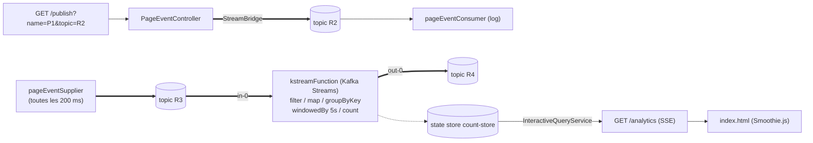

# Kafka + Spring Cloud Stream — Analytique de visites de pages en temps réel

Une application Spring Boot événementielle qui simule des visites de pages, les publie sur Apache Kafka, calcule avec Kafka Streams un comptage fenêtré (5 s) par page et le diffuse en direct au navigateur en Server-Sent Events.

## Présentation

`kafka-spring-cloud-streams` est une démo temps réel construite autour de **Spring Cloud Stream** : le code métier ne manipule que des `Supplier`, `Consumer` et `Function` Java ordinaires, et le binder Kafka se charge de tout le dialogue avec le broker. Trois flux cohabitent :

1. un **producteur REST** (`/publish`) qui injecte des évènements dans le topic `R2` via `StreamBridge`, consommés et journalisés par `pageEventConsumer` ;
2. un **supplier périodique** qui génère une visite toutes les 200 ms vers le topic `R3` ;
3. un **processeur Kafka Streams** (`kstreamFunction`) qui lit `R3`, filtre les visites de moins de 100 ms, regroupe par page et compte les visites par fenêtres de 5 secondes, en matérialisant le résultat dans la banque d'états `count-store`.

Le contrôleur `/analytics` interroge `count-store` via l'`InteractiveQueryService` et pousse les résultats en SSE vers une page `index.html` qui trace les courbes P1/P2 en direct avec Smoothie.js.

L'abstraction du binder garde le code indépendant du broker : remplacer Kafka par RabbitMQ ne change que la configuration et les dépendances.

## Technologies

| Domaine | Choix |
|---|---|
| Langage / build | Java 21, Maven (wrapper jar-less inclus) |
| Framework | Spring Boot 3.4.5, Spring Cloud 2024.0.2 |
| Messagerie | Spring Cloud Stream (binders `kafka` + `kafka-streams`), Reactor (`Flux` SSE) |
| Broker | Apache Kafka 3.8.1 en mode KRaft (single node), via Docker Compose |
| Front | HTML + Smoothie.js (CDN) |
| Outils | Maven Wrapper (only-script), Docker Compose |

## Structure du projet

```text
kafka-spring-cloud-streams
├── compose.yaml                        # broker Kafka (KRaft) pour le dev
├── pom.xml                             # com.saad:kafka-spring-cloud-streams
├── mvnw, mvnw.cmd, .mvn/wrapper/       # wrapper Maven jar-less
└── src/main
    ├── java/com/saad/kafka
    │   ├── KafkaSpringCloudStreamsApplication.java   # point d'entrée
    │   ├── events/PageEvent.java                     # record lié à la requête Kafka (JSON)
    │   ├── handlers/PageEventHandler.java            # Supplier + Consumer de PageEvent
    │   ├── streams/PageVisitTopology.java            # topologie Kafka Streams (fenêtres 5 s)
    │   └── controllers
    │       ├── PageEventController.java              # GET /publish
    │       └── AnalyticsController.java              # GET /analytics (SSE)
    └── resources
        ├── application.properties                    # bindings R2/R3/R4, application.id…
        └── static/index.html                         # chart temps réel
```

## Architecture



**Exposition de l'API** — le projet expose du REST pur via Spring Web :

- `GET /publish` crée un évènement, le renvoie en JSON au client et l'envoie dans le topic demandé (défaut `R2`) grâce à `StreamBridge` ;
- `GET /analytics` est un flux Server-Sent Events (`text/event-stream`) de cartes `{P1: n, P2: n}` rafraîchies chaque seconde depuis la banque d'états ;
- `/` sert la page `index.html` qui s'abonne aux SSE (`EventSource('/analytics')`).

**Topics**

| Topic | Rôle |
|-------|------|
| `R2` | évènements publiés depuis le contrôleur REST |
| `R3` | flux continu produit par le supplier |
| `R4` | comptages fenêtrés produits par Kafka Streams |

## Démarrage

Pré-requis : **JDK 21** et **Docker** (ou un broker Kafka sur `localhost:9092`).

```bash
# 1. Démarrer Kafka (KRaft, single node)
docker compose up -d

# 2. Démarrer l'application (port 8080, http://localhost:8080)
./mvnw spring-boot:run        # ou : mvn spring-boot:run
```

## Endpoints

| Méthode | Endpoint | Description |
|---|---|---|
| GET | `/publish?name=P1&topic=R2` | publie un `PageEvent` (topic `R2` par défaut) et renvoie l'évènement |
| GET | `/analytics` | flux SSE des comptages des 5 dernières secondes |
| GET | `/` | page du graphique temps réel |

**Exemple REST**

```bash
curl "http://localhost:8080/publish?name=P1"
# {"name":"P1","user":"U1","date":"2026-10-22T09:47:12.031+00:00","duration":4231}
```

**Exemple SSE**

```bash
curl -N http://localhost:8080/analytics
# data:{"P1":3}
# data:{"P1":5,"P2":2}
```

Ouvrir ensuite `http://localhost:8080/` pour voir les courbes P1/P2 se dessiner en direct.

## Travail réalisé

1. Initialisation du projet Spring Boot (Java 21, parent 3.4.5, Spring Cloud 2024.0.2) avec wrapper Maven jar-less.
2. Conception du modèle d'évènement `PageEvent` (record : page, utilisateur, date, durée).
3. Implémentation du « bean-messagerie » `PageEventHandler` : supplier périodique de visites et consumer de journalisation, reliés au binder Kafka.
4. Écriture de la topologie Kafka Streams `PageVisitTopology` : filtrage des visites courtes, re-key par page, fenêtres de tumbling 5 s et matérialisation dans `count-store`.
5. Exposition de l'endpoint REST `/publish` basé sur `StreamBridge`.
6. Exposition du flux SSE `/analytics` fondé sur l'`InteractiveQueryService` (real-time query sur la banque d'états).
7. Création de la page de visualisation `index.html` (Smoothie.js) branchée sur le flux SSE.
8. Configuration des bindings Spring Cloud Stream (`R2`, `R3`, `R4`), de l'`application.id` et du compose Kafka KRaft.
9. Correction qualité : journalisation SLF4J, générateur aléatoire partagé, gestion d'erreur SSE côté client.
10. Documentation et identité de projet (README, coordonnées Maven, bloc développeur).

## Améliorations possibles

- **Tests** : tests d'intégration de la topologie (TopologyTestDriver, binder de test) et tests de contrôleur.
- **API GraphQL** : une couche GraphQL (Spring for GraphQL) pourrait exposer l'historique des fenêtres en requêtes plutôt qu'en flux poussé.
- **Persistance / observabilité** : exporter les comptages vers Prometheus/Grafana, actuator + healthcheck du binder.
- **Fiabilité** : acknowledgements manuels, gestion des erreurs de désérialisation, redémarrage du state store.
- **Industrialisation** : CI GitHub Actions, stack compose complète (Kafka + app), authentification sur `/publish`.

---

**Saad Ait Saidou-Ali — Projet réalisé dans le cadre du module Systèmes Distribués et DevOps — ENSET Mohammedia**
